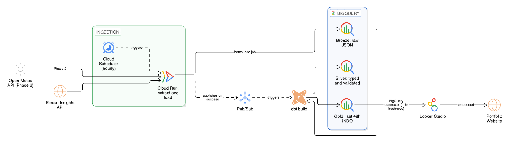

# GB National Demand (INDO) Forecasting Pipeline

An end-to-end data pipeline for extracting, transforming and visualising Great Britain's Initial National Demand Outturn (INDO). The project uses a Medallion Architecture on Google Cloud Platform, built from serverless components and designed to run within GCP's free tiers. A day-ahead INDO forecasting model will be added in Phase 2.

## Architecture Overview



Runs are started by Cloud Scheduler. Each subsequent stage is triggered by a Pub/Sub event, and all transformations are written in SQL with dbt.

1. **Scheduling (Cloud Scheduler):** Cloud Scheduler starts the ingestion job every hour.

2. **Extraction and Loading (Cloud Run):** A single containerised Python job polls the Elexon Insights Solution API and loads the response straight into the BigQuery Bronze layer using a batch load job. The raw JSON is stored without schema inference, preserving the exact API response.

3. **Event Triggering (Pub/Sub):** On a successful load, the job publishes a message to a Pub/Sub topic, which triggers the transformation step.

4. **Transformation (dbt Core):** A single `dbt build` creates both layers in dependency order:

   * **Silver Layer:** Unpacks JSON, casts data types, handles timezone conversions and validates GB power market quirks (e.g. asserting 46/48/50 Settlement Periods depending on clock change days).
   * **Gold Layer:** Materialises a small table containing the most recent 48 hours of INDO for dashboard consumption.

5. **Serving (Looker Studio):** A dashboard visualises INDO via Looker Studio's BigQuery connector, with data freshness set to one hour so that cached results are reused between refreshes. The dashboard is embedded on my portfolio website.

## Current Repository Structure
```text
power_dashboard_proj/
│
├── docs/
│
└── README.md
```

## Planned Repository Structure
```text
power_dashboard_proj/
│
├── .github/
│   └── workflows/
│       ├── deploy_ingestion.yml      # CI/CD to deploy the ingestion job to Cloud Run
│       └── deploy_dbt.yml            # CI/CD to deploy the dbt project
│
├── data_ingestion/                   # Python Cloud Run job (extract and load)
│   ├── Dockerfile                    # Container definition for the ingestion job
│   ├── requirements.txt
│   ├── src/
│   │   ├── elexon_api.py             # Pulls INDO demand
│   │   ├── openmeteo_api.py          # Pulls weather for UK hubs (Phase 2)
│   │   └── bq_loader.py              # Batch-loads raw JSON into BigQuery (Bronze)
│   └── tests/                        # Pytest suite for the ingestion logic
│
├── dbt_transform/                    # dbt project (Silver & Gold layers)
│   ├── dbt_project.yml
│   ├── profiles.yml.example          # Template BigQuery connection profile
│   ├── models/
│   │   ├── staging/                  # Bronze -> Silver
│   │   │   ├── stg_elexon_demand.sql # Casts types, standardises Settlement Periods
│   │   │   ├── stg_weather.sql
│   │   │   └── schema.yml            # Data quality tests (e.g. clock change checks)
│   │   └── marts/                    # Silver -> Gold
│   │       ├── fct_gb_demand.sql     # Joins demand and weather, adds lag features
│   │       └── schema.yml
│   └── macros/                       # Custom SQL functions (e.g. calculate_sp_time)
│
├── docs/
│
├── notebooks/                        # EDA and prototyping (connected to Silver)
│   ├── 01_weather_correlation.ipynb
│   ├── 02_demand_seasonality.ipynb
│   └── 03_baseline_model_tests.ipynb
│
├── ml_training/                      # Python ML pipeline (if not using BigQuery ML)
│   ├── Dockerfile
│   ├── requirements.txt
│   └── src/
│       ├── train.py                  # Pulls Gold data and trains the model
│       └── predict.py                # Generates the day-ahead forecast and writes it to BigQuery
│
├── README.md
└── .gitignore                        # Includes profiles.yml and credentials
```

## Domain-Specific Logic Handled

* **Elexon Insights Solution API:** Built exclusively on the modern REST API, avoiding the legacy BMRS API, which Elexon has deprecated.
* **Clock Change Resilience:** The dbt Silver layer includes custom tests for British Summer Time (BST) transitions, ensuring 46 Settlement Periods in spring and 50 in autumn.

## Design Decisions

* **Cost Control:** The Gold table is kept deliberately small, and Looker Studio's one-hour data freshness cache limits BigQuery queries to roughly one per chart per hour, regardless of dashboard traffic. This keeps usage well within the BigQuery 1 TB/month free query allowance, and a custom daily bytes-billed quota on the project acts as a hard cap against unexpected costs.

## Current Stage (Phase 1)

* Build and deploy the ingestion and transformation pipeline for INDO data.
* Display INDO on a dashboard updated hourly.

## Next Steps (Phase 2)

* Integrate the Open-Meteo API for population-weighted temperature metrics.
* Deploy a forecasting model to predict day-ahead INDO.